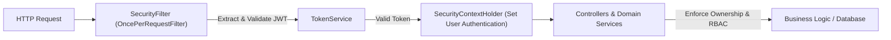
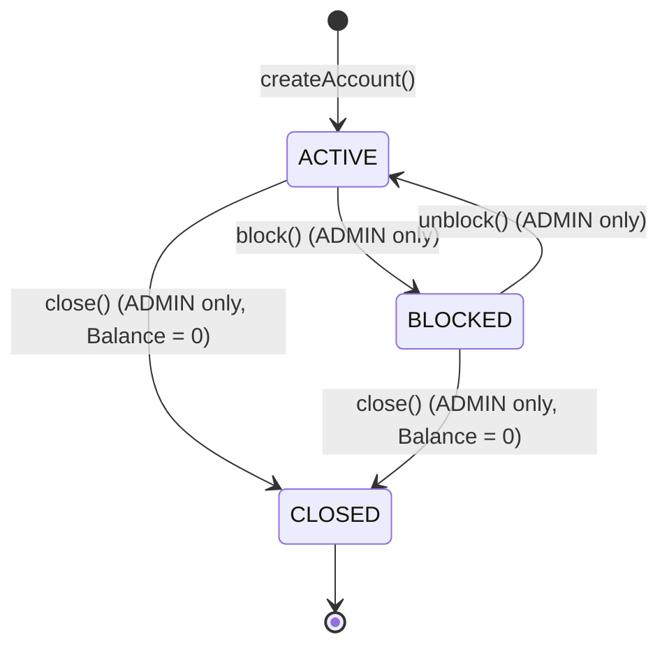

# 🏦 DigitalBank API

[](https://www.oracle.com/java/)
[](https://spring.io/projects/spring-boot)
[](https://spring.io/projects/spring-security)
[](https://spring.io/projects/spring-data-jpa)
[](https://swagger.io/)
[](https://www.h2database.com/)
[](LICENSE)

A robust, enterprise-grade RESTful Banking API developed in **Java 21** and **Spring Boot**, simulating the core financial operations of a modern digital bank.

The project emphasizes **Clean Architecture**, **Domain-Driven Design (DDD)** principles, **Role-Based Access Control (RBAC)**, **OWASP-aligned Resource-Level Authorization (IDOR mitigation)**, and a production-grade centralized exception handling framework with standardized error payloads.

---

## 📑 Table of Contents

- [Overview](#-overview)
- [Key Features](#-key-features)
- [Security Architecture](#-security-architecture)
  - [Authentication & JWT](#1-stateless-authentication-jwt)
  - [Role-Based Access Control (RBAC)](#2-role-based-access-control-rbac)
  - [Object-Level Authorization (Ownership Check)](#3-object-level-authorization-idor-mitigation)
- [Architecture & Design Decisions](#-architecture--design-decisions)
- [Domain Model](#-domain-model)
- [Exception Handling Framework](#-exception-handling-framework)
- [Interactive API Documentation (Swagger)](#-interactive-api-documentation-swagger)
- [API Endpoints Reference](#-api-endpoints-reference)
  - [Authentication](#authentication)
  - [Account Operations](#account-operations)
  - [Transactions & Balance Operations](#transactions--balance-operations)
  - [Transfers](#transfers)
  - [Bank Statement](#bank-statement)
- [Getting Started](#-getting-started)
- [Author](#-author)

---

## 💡 Overview

DigitalBank was engineered to reflect real-world banking backend patterns:

* **Precise Monetary Calculations**: Handled exclusively via `BigDecimal` to prevent floating-point rounding inaccuracies.
* **ACID Transactions**: Backed by Spring's `@Transactional`, ensuring automatic rollbacks upon unexpected errors during financial operations.
* **Defensive Programming & Fail-Fast**: Validations occur both at API entry (via Bean Validation) and deeply within Domain Services.
* **Context-Aware Security**: Powered by Spring Security + `SecurityContextHolder`, ensuring users can never operate on or inspect accounts they do not own.
* **Standardized JSON Error Payloads**: Compliant with standard error patterns through a custom `StandardError` structure.

---

## 🚀 Key Features

* **Authentication & User Management**:
  * User registration with encrypted passwords via `BCryptPasswordEncoder`.
  * Stateless token-based login returning HMAC256-signed **JSON Web Tokens (JWT)**.
  * Roles: `ADMIN` (Bank Managers) and `USER` (Account Holders).
* **Account Lifecycle Management**:
  * Open accounts linked directly to the authenticated user from the security context.
  * Status transitions: `ACTIVE` ⇄ `BLOCKED` ➔ `CLOSED`.
  * Management actions (`block`, `unblock`, `close`) restricted strictly to `ADMIN` roles.
  * Zero-balance enforcement before account termination.
* **Financial Operations**:
  * **Self-Service Deposits**: Credit balance into the authenticated user's account.
  * **Withdrawals**: Ensure account activity, verify sufficient balance, and debit funds.
  * **Inter-Account Transfers**: Atomic, cross-account fund movements with double-status validation and self-transfer prevention.
* **Strict Bank Statement Auditing**:
  * Real-time audit records stored with precise timestamps (`LocalDateTime`).
  * Strict bank secrecy: users can only inspect their own bank statements.

---

## 🔒 Security Architecture



### 1. Stateless Authentication (JWT)
* No HTTP sessions are stored on the server (`SessionCreationPolicy.STATELESS`).
* Incoming requests pass through a custom `SecurityFilter` (`OncePerRequestFilter`) validating the `Authorization: Bearer <token>` header.

### 2. Role-Based Access Control (RBAC)
Configured declaratively in `SecurityConfiguration`:
* **Public**: `/auth/**`, `/swagger-ui/**`, `/v3/api-docs/**`, `/h2-console/**`.
* **ADMIN Only (`hasRole('ADMIN')`)**: Managerial actions like `/accounts/*/block`, `/accounts/*/unblock`, and `/accounts/*/closed`.
* **Authenticated (`authenticated()`)**: Financial operations and inquiries.

### 3. Object-Level Authorization (IDOR Mitigation)
Merely checking if a user is logged in is insufficient in banking systems. The application implements an **Ownership Verification Guard**:
* When attempting to deposit, withdraw, transfer from, or view the statement of account `X`, the service queries `SecurityContextHolder`.
* If `account.getUser().getId() != authenticatedUser.getId()` and the user is not an `ADMIN`, the operation is aborted immediately with `403 FORBIDDEN` (`AcessDeniedException`).

---

## 🏛️ Architecture & Design Decisions

```
src/main/java/dev/luan/digitalbank/
├── controller/        # REST Controllers (Account, Transaction, Transfer, Authentication)
├── service/           # Business Rules & Orchestration Layer
├── repository/        # Spring Data JPA Repositories
├── entities/          # JPA Entities (Account, Transaction, User)
├── domain/            # Domain Enums (AccountStatus, TransactionType, UserRole)
├── DTO/               # Data Transfer Objects & User DTOs (RegisterDTO, LoginResponseDTO, etc.)
├── security/          # SecurityConfig, SecurityFilter, TokenService
└── exceptions/        # Custom Domain Exceptions & GlobalExceptionHandler
```

---

## 🧱 Domain Model

### Account States (`AccountStatus`)


---

## 🛡️ Exception Handling Framework

The application maps domain rule violations to semantic HTTP status codes, captured by `@RestControllerAdvice` (`GlobalExceptionHandler`) and returned as formatted `StandardError` payloads:

```json
{
  "timestamp": "2026-10-30T19:40:00Z",
  "status": 403,
  "error": "Access denied",
  "message": "You can only transfer from your own account!",
  "path": "/transfers/1/2"
}
```

### Exception Mapping Matrix:

| Exception | Cause / Trigger | HTTP Status |
| :--- | :--- | :--- |
| `AccountNotFoundException` | Account ID does not exist | `404 Not Found` |
| `InvalidAmountException` | Amount is null, zero, or negative (`<= 0`) | `400 Bad Request` |
| `MethodArgumentNotValidException` | DTO fails Bean Validation constraints (`@NotBlank`, `@NotNull`, etc.) | `400 Bad Request` |
| `HttpMessageNotReadableException` | Malformed JSON or missing request body | `400 Bad Request` |
| `AcessDeniedException` | User attempts to operate on another user's account without `ADMIN` role | `403 Forbidden` |
| `InsufficientBalanceException` | Withdrawal or transfer exceeds account balance | `422 Unprocessable Entity` |
| `AccountBlockedException` | Operation attempted on `BLOCKED` account | `422 Unprocessable Entity` |
| `AccountClosedException` | Operation attempted on `CLOSED` account | `422 Unprocessable Entity` |
| `SameAccountTransferException` | Sender and recipient account IDs are identical | `422 Unprocessable Entity` |
| `AccountHasBalanceException` | Attempting to close an account with balance `> 0` | `409 Conflict` |

---

## 📖 Interactive API Documentation (Swagger)

The project includes **SpringDoc OpenAPI**. When running the application locally, you can explore, test, and view schemas for all endpoints via Swagger UI:

🔗 **Swagger UI:** [http://localhost:8080/swagger-ui.html](http://localhost:8080/swagger-ui.html)  
🔗 **OpenAPI Spec:** [http://localhost:8080/v3/api-docs](http://localhost:8080/v3/api-docs)

---

## 📡 API Endpoints Reference

Base URL: `http://localhost:8080`

### Authentication

#### 1. Register a User
* **Endpoint:** `POST /auth/register`
* **Access:** Public
* **Request Body:**
```json
{
  "login": "john_doe",
  "password": "secretPassword123",
  "role": "USER"
}
```
* **Success Response:** `200 OK`

#### 2. User Login
* **Endpoint:** `POST /auth/login`
* **Access:** Public
* **Request Body:**
```json
{
  "login": "john_doe",
  "password": "secretPassword123"
}
```
* **Success Response:** `200 OK`
```json
{
  "token": "eyJhbGciOiJIUzI1NiIsInR5cCI6IkpXVCJ9..."
}
```

---

### Account Operations

> ⚠️ All subsequent requests require the header: `Authorization: Bearer <your_jwt_token>`

#### 1. Create Account
* **Endpoint:** `POST /accounts/create`
* **Access:** Authenticated
* **Request Body:**
```json
{
  "document": "123.456.789-00",
  "holderName": "John Doe",
  "accountNumber": 1001,
  "balance": null
}
```
* **Success Response:** `201 Created` (`Location: /accounts/{id}`)

#### 2. Get Account by ID
* **Endpoint:** `GET /accounts/{id}`
* **Access:** Authenticated

#### 3. Block / Unblock / Close Account
* **Endpoints:** 
  * `PATCH /accounts/{id}/block`
  * `PATCH /accounts/{id}/unblock`
  * `PATCH /accounts/{id}/closed`
* **Access:** `ADMIN` role only (`403 Forbidden` for regular `USER`)

---

### Transactions & Balance Operations

#### 1. Deposit Funds
* **Endpoint:** `POST /accounts/{id}/deposit`
* **Access:** Account Owner or `ADMIN`
* **Request Body:** `150.00`
* **Success Response:** `200 OK` (Updated `AccountDTO`)

#### 2. Withdraw Funds
* **Endpoint:** `POST /accounts/{id}/withdraw`
* **Access:** Account Owner or `ADMIN`
* **Request Body:** `50.00`
* **Success Response:** `200 OK` (Updated `AccountDTO`)

---

### Transfers

#### Transfer Between Accounts
* **Endpoint:** `POST /transfers/{sourceId}/{targetId}`
* **Access:** Owner of `sourceId` or `ADMIN`
* **Request Body:** `100.00`
* **Success Response:** `204 No Content`

---

### Bank Statement

#### Get Account Statement
* **Endpoint:** `GET /transactions/{id}/extract`
* **Access:** Account Owner or `ADMIN`
* **Success Response:** `200 OK`
```json
[
  {
    "id": 1,
    "type": "DEPOSIT",
    "amount": 200.00,
    "createdAt": "2026-10-30T14:30:15",
    "sourceAccountId": null,
    "targetAccountId": 1
  },
  {
    "id": 2,
    "type": "TRANSFER",
    "amount": 50.00,
    "createdAt": "2026-10-30T15:10:42",
    "sourceAccountId": 1,
    "targetAccountId": 2
  }
]
```

---

## 💻 Getting Started

### Prerequisites
* **Java Development Kit (JDK) 21**
* **Apache Maven 3.9+** (or use the provided `./mvnw` wrapper)
* Git

### Installation & Running

1. **Clone the repository:**
   ```bash
   git clone https://github.com/Ghostsr30/DigitalBank.git
   cd DigitalBank
   ```

2. **Compile and build:**
   ```bash
   mvn clean install
   ```

3. **Run the application:**
   ```bash
   mvn spring-boot:run
   ```

The application will start on port `8080`.

### Database Console (H2)
* **URL:** `http://localhost:8080/h2-console`
* **JDBC URL:** `jdbc:h2:mem:bankdb`
* **User:** `sa`
* **Password:** *(empty)*

---

## 👤 Author

Developed by **Luan Vedovoto**
* GitHub: [@Ghostsr30](https://github.com/Ghostsr30)
