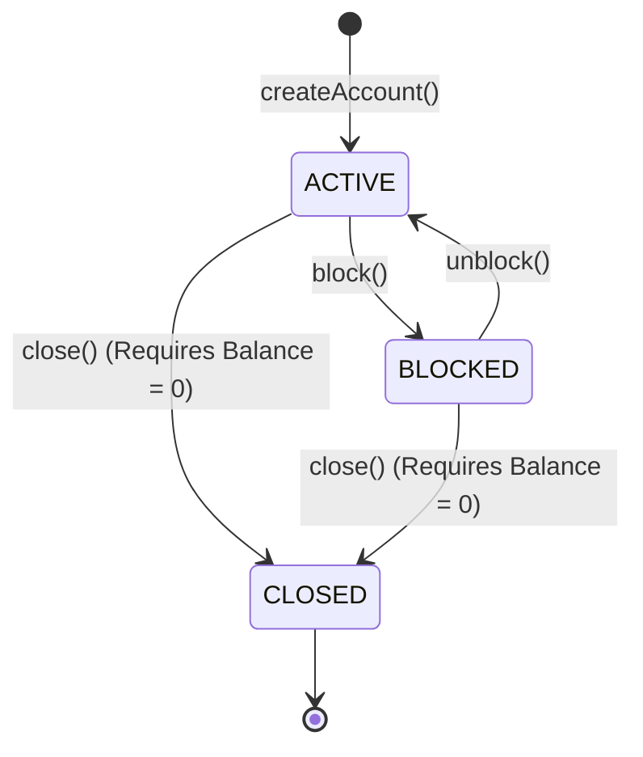
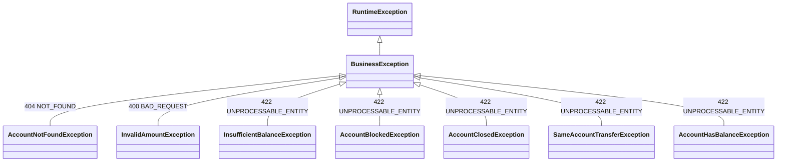

# 🏦 DigitalBank API

[](https://www.oracle.com/java/)
[](https://spring.io/projects/spring-boot)
[](https://spring.io/projects/spring-data-jpa)
[](https://www.h2database.com/)
[](LICENSE)

A robust, production-ready RESTful Banking API developed in **Java 21** and **Spring Boot**, simulating the core financial operations of a digital bank.

The project emphasizes **Clean Architecture**, **Domain-Driven Design (DDD)** principles, transactional consistency (ACID compliance), and an enterprise-grade hierarchical business exception handling architecture.

---

## 📑 Table of Contents

- [Overview](#-overview)
- [Key Features](#-key-features)
- [Architecture & Design Decisions](#-architecture--design-decisions)
- [Domain Model](#-domain-model)
- [Exception Handling Architecture](#-exception-handling-architecture)
- [API Documentation](#-api-documentation)
  - [Account Operations](#account-operations)
  - [Transactions & Balance Operations](#transactions--balance-operations)
  - [Transfers](#transfers)
  - [Bank Statement](#bank-statement)
- [Getting Started](#-getting-started)
  - [Prerequisites](#prerequisites)
  - [Installation & Running](#installation--running)
  - [H2 Database Console](#h2-database-console)
- [Author](#-author)

---

## 💡 Overview

DigitalBank was engineered to go beyond standard CRUD tutorials. It focuses on how mission-critical financial applications maintain **data integrity**, **idempotency**, and **business predictability**:

* **Precise Monetary Calculations**: Handled exclusively through `BigDecimal` to eliminate floating-point rounding errors.
* **Atomic Operations**: Powered by Spring's declarative `@Transactional` management, ensuring automated database rollbacks if any failure occurs during balance mutations.
* **Fail-Fast Validation**: Every endpoint enforces rigorous domain rules before executing mutations.
* **Semantic HTTP Status Codes**: Eradicating ambiguous `500 Internal Server Error` responses in favor of precise client feedback (`400`, `404`, `409`, `422`).

---

## 🚀 Key Features

* **Account Lifecycle Management**:
  * Create accounts with unique document (CPF/CNPJ) and account numbers.
  * Status workflow transitions: `ACTIVE` ⇄ `BLOCKED` ➔ `CLOSED`.
  * Guard rules preventing operations or state modifications on closed accounts.
  * Zero-balance enforcement before account termination.
* **Financial Operations**:
  * **Deposits**: Credit funds into active accounts and log transactions.
  * **Withdrawals**: Check account availability, assert minimum balance, debit funds, and log transactions.
  * **Inter-Account Transfers**: Orchestrate simultaneous debit and credit across two accounts with full atomic isolation and validation against self-transfers.
* **Audit Trail & Bank Statement**:
  * Chronologically ordered transaction history (`DEPOSIT`, `WITHDRAW`, `TRANSFER`).
  * Bidirectional tracking (queries records where the account is either source or destination).

---

## 🏛️ Architecture & Design Decisions

The codebase adheres to the classic layered architectural pattern:

```
src/main/java/dev/luan/digitalbank/
├── controller/        # REST Endpoints (Presentation Layer)
├── service/           # Business Rules & Orchestration Layer
├── repository/        # Spring Data JPA Repositories (Data Access Layer)
├── entities/          # Relational JPA Entities (Persistence Layer)
├── domain/            # Domain Enums (AccountStatus, TransactionType)
├── DTO/               # Data Transfer Objects (Decoupling entities from API)
└── exceptions/        # Custom Business Exception Hierarchy & Global Handler
```

### Highlights:
1. **Separation of Concerns**: Entities never leak directly into the API output; all responses pass through dedicated `DTO` classes.
2. **Transaction Immutability**: The `Transaction` entity does not expose setters. Once created, transactions are permanent audit records created exclusively via **Static Factory Methods** (`Transaction.deposit(...)`, `Transaction.withdrawal(...)`, `Transaction.transfer(...)`).
3. **Lazy Loading**: Relationship mapping (`@ManyToOne(fetch = FetchType.LAZY)`) avoids the N+1 query problem and optimizes memory allocation.

---

## 🧱 Domain Model

### Account States (`AccountStatus`)


### Transaction Types (`TransactionType`)
- `DEPOSIT`: External funds credited to an account (`sourceAccount = null`, `targetAccount = Account`).
- `WITHDRAW`: Funds debited from an account (`sourceAccount = Account`, `targetAccount = null`).
- `TRANSFER`: Funds moved between two different accounts (`sourceAccount = AccountA`, `targetAccount = AccountB`).

---

## 🛡️ Exception Handling Architecture

Instead of returning generic runtime exceptions, the application defines a custom hierarchy rooted in `BusinessException`.



### Centralized Exception Handler
A single `@RestControllerAdvice` (`GlobalExceptionHandler`) intercepts all domain exceptions polymorphically:

```java
@RestControllerAdvice
public class GlobalExceptionHandler {

    @ExceptionHandler(BusinessException.class)
    public ResponseEntity<String> handleBusinessException(BusinessException ex) {
        return ResponseEntity.status(ex.getStatus()).body(ex.getMessage());
    }
}
```

### Error Code Mapping:

| Exception | Trigger Condition | HTTP Status |
| :--- | :--- | :--- |
| `AccountNotFoundException` | Account ID does not exist in database | `404 Not Found` |
| `InvalidAmountException` | Amount is null, zero, or negative (`<= 0`) | `400 Bad Request` |
| `InsufficientBalanceException` | Account balance is less than withdrawal/transfer amount | `422 Unprocessable Entity` |
| `AccountBlockedException` | Operation attempted on an account with status `BLOCKED` | `422 Unprocessable Entity` |
| `AccountClosedException` | Any operation or modification attempted on a `CLOSED` account | `422 Unprocessable Entity` |
| `SameAccountTransferException` | Transfer requested where `sourceId == targetId` | `422 Unprocessable Entity` |
| `AccountHasBalanceException` | Attempt to close an account that still holds a balance (`> 0`) | `422 Unprocessable Entity` |

---

## 📖 API Documentation

Base URL: `http://localhost:8080`

### Account Operations

#### 1. Create a New Account
* **Endpoint:** `POST /accounts/create`
* **Request Body:**
```json
{
  "document": "123.456.789-00",
  "holderName": "John Doe",
  "accountNumber": 1001,
  "balance": 0.00
}
```
* **Success Response:** `201 Created`
* **Headers:** `Location: /accounts/1`

---

#### 2. Get Account by ID
* **Endpoint:** `GET /accounts/{id}`
* **Success Response:** `200 OK`
```json
{
  "id": 1,
  "accountNumber": 1001,
  "holderName": "John Doe",
  "balance": 250.00,
  "status": "ACTIVE",
  "document": "123.456.789-00"
}
```

---

#### 3. Block Account
* **Endpoint:** `PATCH /accounts/{id}/block`
* **Success Response:** `200 OK` (Account status becomes `BLOCKED`)

---

#### 4. Unblock Account
* **Endpoint:** `PATCH /accounts/{id}/unblock`
* **Success Response:** `200 OK` (Account status becomes `ACTIVE`)

---

#### 5. Close Account
* **Endpoint:** `PATCH /accounts/{id}/closed`
* **Pre-condition:** Account balance must be `0.00`.
* **Success Response:** `200 OK` (Account status becomes `CLOSED`)

---

### Transactions & Balance Operations

#### 1. Deposit Funds
* **Endpoint:** `POST /accounts/{id}/deposit`
* **Request Body:** *(Raw decimal amount)*
```json
150.00
```
* **Success Response:** `200 OK` (Updated `AccountDTO`)

---

#### 2. Withdraw Funds
* **Endpoint:** `POST /accounts/{id}/withdraw`
* **Request Body:** *(Raw decimal amount)*
```json
50.00
```
* **Success Response:** `200 OK` (Updated `AccountDTO`)

---

### Transfers

#### Transfer Between Accounts
* **Endpoint:** `POST /transfers/{sourceId}/{targetId}`
* **Request Body:** *(Raw decimal amount)*
```json
100.00
```
* **Success Response:** `204 No Content`
* **Behavior:**
  * Checks both accounts for existence and `ACTIVE` status.
  * Asserts `sourceId != targetId`.
  * Verifies sender has sufficient funds.
  * Atomically debits sender, credits receiver, and registers a `TRANSFER` audit record.

---

### Bank Statement

#### Get Account Statement / Extraction
* **Endpoint:** `GET /transactions/{id}/extract`
* **Success Response:** `200 OK`
```json
[
  {
    "id": 1,
    "type": "DEPOSIT",
    "amount": 200.00,
    "createdAt": "2026-10-14",
    "sourceAccountId": null,
    "targetAccountId": 1
  },
  {
    "id": 2,
    "type": "TRANSFER",
    "amount": 50.00,
    "createdAt": "2026-10-14",
    "sourceAccountId": 1,
    "targetAccountId": 2
  }
]
```

---

## 💻 Getting Started

### Prerequisites
* **Java Development Kit (JDK) 21** or higher
* **Apache Maven 3.9+** (or use the included `./mvnw` wrapper)
* Git

### Installation & Running

1. **Clone the repository:**
   ```bash
   git clone https://github.com/your-username/DigitalBank.git
   cd DigitalBank
   ```

2. **Build and test the application:**
   ```bash
   mvn clean install
   ```

3. **Run the Spring Boot application:**
   ```bash
   mvn spring-boot:run
   ```

The application will start on port `8080` (`http://localhost:8080`).

---

### H2 Database Console

The project is preconfigured with an in-memory **H2 Database**. You can inspect tables and run queries via your browser while the server is running:

* **URL:** `http://localhost:8080/h2-console`
* **Driver Class:** `org.h2.Driver`
* **JDBC URL:** `jdbc:h2:mem:bankdb`
* **User Name:** `sa`
* **Password:** *(leave blank)*

---

## 👤 Author

Developed by **Luan Vedovoto**
* GitHub: [@Ghostsr30](https://github.com/Ghostsr30)
* LinkedIn: [Luan Vedovoto](https://linkedin.com)

Feel free to open an issue or submit pull requests for feedback and contributions!
